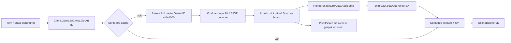

# Ağ ve asset katmanları — yeni taban

İncelenen dal `analiz/build-network-v2`, taban `main` / `18da1d91d` (D-002: upstream `ee79d7eb`); tarih 16 Ekim 2026. Eski `e5595b222` haritasının sınıf yolları ve cache varsayımları burada geçerli değildir. İnceleme ve MIG-6 sırasında oyun kodu değiştirilmedi.

## Proje sınırları ve sürüm seçimi

| Proje / giriş noktası | Sorumluluk |
| --- | --- |
| `src/ClassicUO.Client/Main.cs` — `Bootstrap.Main()` / `Boot()` | Ayarlar, native DLL eşleme, ilk veri/sürüm kontrolü; `Client.Run()` |
| `src/ClassicUO.Client/Client.cs` — `UltimaOnline` | `LoadUOFiles()`: sürüm/protokol bayrakları, dosya override haritası, `UOFileManager`; `Load()`: GPU kaynaklarını loader'lara bağlar, `World` oluşturur |
| `src/ClassicUO.Assets/UOFileManager.cs` — `UOFileManager` | Örnek bazlı loader sahibi; `Load()`, `GetUOFilePath()`, `Dispose()` |
| `src/ClassicUO.IO/` | Memory-mapped dosyalar, MUL/UOP index'leri, `StackDataReader`, `StackDataWriter`, dosya override haritası |
| `src/ClassicUO.Renderer/` | CPU piksellerini texture atlasına yükleme, sprite/UV cache'i ve piksel seçim maskeleri |

**D-003 sınırı:** `settings.clientversion` yalnız sunucuya bildirilen metin değildir. `UltimaOnline.LoadUOFiles()` aynı sürümü `UOFileManager(clientVersion, path, ...)` kurucusuna geçirir; `GameController.LoadContent()` da bununla `NetClient.Socket.Load()` çağırır. Tiledata, harita, animasyon ve diğer loader'larda sürüm dalları vardır. Veri klasörü farklı sürümde olabilir; fakat bütün loader davranışları bağımsız bir “veri sürümü” ayarından seçilmez. Bu nedenle 7.0.112.75 dosyaları + 7.0.20.0 protokol ayarı MIG-5'te gerçekten denenmelidir. Giriş ekranı sonucu oyun içi uyumu kanıtlamaz.

`UOFileManager.IsUOPInstallation`, sürüm `>= 7.0.0.0` ve `MainMisc.uop` varlığına bağlıdır; loader'lar ayrıca kendi UOP dosyalarının varlığını kontrol eder. 7.0.20.0 ayarı bu ilk koşulu karşılar. Güncel Cliloc ve gump çözümü içerik/sıkıştırma türünü de kullanır.

## Bağlantı ve paket akışı

```mermaid
sequenceDiagram
    participant L as LoginScene
    participant N as NetClient.Socket
    participant S as Login sunucusu
    participant W as Oyun sunucusu
    L->>N: Connect(settings IP, port)
    N->>S: Seed (0xEF veya eski ham seed) + 0x80
    S-->>L: 0xA8 sunucu listesi
    L->>S: 0xA0 sunucu seçimi
    S-->>L: 0x8C relay IP, port, seed
    L->>N: Disconnect + Connect(relay)
    Note over N: Aynı NetClient örneği; wrapper yeniden kurulur
    N->>W: Ham seed + 0x91, oyun şifreleme/Huffman etkin
    W-->>L: 0xA9 karakter listesi
    L->>W: 0x5D karakter seçimi
    W-->>N: 0x1B EnterWorld
    W-->>N: 0x55 LoginComplete → GameScene
```

Eski fork'taki ayrı `LoginSocket` artık yok. `LoginScene.HandleRelayServerPacket()` aynı `NetClient.Socket` üzerinde bağlantıyı kapatır, yeniden bağlanır. `ignore_relay_ip=true` veya relay IP'si sıfırsa ayarlardaki **IP ve port** tekrar kullanılır; diğer durumda relay IP/portu kullanılır. TCP/WebSocket wrapper türü ilk bağlantıyla belirlenir, relay sırasında korunur.

| Dosya / sınıf | Sorumluluk ve önemli metotlar |
| --- | --- |
| `src/ClassicUO.Client/Game/Scenes/LoginScene.cs` — `LoginScene` | `Connect()`, `OnNetClientConnected()`, `SelectServer()`, `SelectCharacter()`, `ServerListReceived()`, `ReceiveCharacterList()`, `UpdateCharacterList()`, `HandleRelayServerPacket()` |
| `src/ClassicUO.Client/Network/NetClient.cs` — `NetClient` | Tek `Socket`; `Load()` sürümlü paket tablosu ve isteğe bağlı şifreleme; `Connect()`, `CollectAvailableData()`, `Send()`, `Flush()`, `EnableCompression()`, `Disconnect()` |
| `src/ClassicUO.Client/Network/Socket/SocketWrapper.cs`, `TcpSocketWrapper.cs`, `WebSocketWrapper.cs` | Taşıma soyutlaması; `Connect`, `Read`, `Send`, bağlılık/hata olayları; Nimloth IP örneği TCP yolunu kullanır |
| `src/ClassicUO.Client/Network/PacketHandlers.cs` — `PacketHandlers` | Statik kurucuda `Handler.Add(id, handler)` kayıtları; `ParsePackets()`, `Append()`, `GetPacketInfo()`, `AnalyzePacket()`; imza `World, ref StackDataReader` |
| `src/ClassicUO.Client/Network/PacketsTable.cs` — `PacketsTable` | Kurucu sürüme göre uzunlukları ayarlar; `GetPacketLength()`; `-1` dinamik paket, aksi sabit uzunluk |
| `src/ClassicUO.Client/Network/OutgoingPackets.cs` — `NetClientExt` | `Send_Seed()`, `Send_FirstLogin()`, `Send_SelectServer()`, `Send_SecondLogin()`, `Send_SelectCharacter()`, `Send_ClientVersion()` gibi extension metotları |
| `src/ClassicUO.IO/StackDataReader.cs`, `StackDataWriter.cs` | Span tabanlı paket okuma/yazma; protokol alanlarında `ReadUInt32BE`, `WriteUInt16BE` gibi açık endian metotları; dosya okumada LE dalları da var |
| `src/ClassicUO.Client/Network/Encryption/Encryption.cs` — `EncryptionHelper` | Örnek bazlı, sürümden algoritma/anahtar türetir; `Initialize()`, `Encrypt()`, `Decrypt()`; aynı klasörde login crypt, Blowfish, Twofish ve MD5 |
| `src/ClassicUO.Client/Network/Huffman.cs` — `Huffman` | Oyun akışının açılması; `Decompress()`, `Reset()` |
| `src/ClassicUO.Client/Network/Plugin.cs`, `PacketLogger.cs` | Gönderim/alım filtresi ve isteğe bağlı paket günlüğü; eklentiler ayrı buffer üzerinden paket ekleyebilir |
| `src/ClassicUO.Client/GameController.cs` — `GameController` | `LoadContent()` ağ sürümünü kurar; `Update()` alım → parse → flush sırasını işletir |

Alım: `GameController.Update()` → `NetClient.CollectAvailableData()` → wrapper `Read()` → oyun aşamasında decrypt → Huffman → `PacketHandlers.ParsePackets()` tamponu → sabit/dinamik uzunluk ayrımı → eklenti filtresi → `AnalyzePacket()` → handler. Dinamik başlık 3, sabit başlık 1 bayttır; tamamlanmamış paket buffer'da kalır. `Packet`/`PacketWriter` sınıfları yerine stack reader/writer kullanılır.

Gönderim: `NetClientExt.Send_*()` → `StackDataWriter` → `NetClient.Send()` → eklenti → günlük → şifreleme → `_sendStream`; `Flush()`/`ProcessSend()` gerçek wrapper gönderimini yapar. Seed özel olarak filtre/şifrelemeyi atlayabilir. `encryption=0` kapalı; sıfırdan farklıysa `NetClient.Load()` sürüme göre algoritmayı seçer ve ayarı güncelleyebilir. Login şifrelemesi ile oyun şifrelemesi seed aşamasında ayrı başlatılır. Asset zlib/BWT çözümü, ağ Huffman'ından ayrıdır.

Login paketleri artık `PacketHandlers` üzerinden sahne metotlarına yönlenir: `0xA8`, `0x8C`, `0x86`, `0xA9`; `0x82/0x85/0x53` reddetme/hata yollarıdır. `EnterWorld(0x1B)` oyuncu/profil/haritayı hazırlar; `LoginComplete(0x55)` `GameScene` oluşturur. Sürüm isteği `0xBD`'dir.

## Işık, saat ve hava

Kayıt ve uygulama `src/ClassicUO.Client/Network/PacketHandlers.cs`; uzunluklar `PacketsTable.cs` içinde kimlik dahil:

| Paket | Handler / uzunluk | Güncellediği durum |
| --- | --- | --- |
| `0x4E` | `PersonalLightLevel()`, 6 | `world.InGame` ve serial oyuncuya aitse; seviye en çok 30; `world.Light.RealPersonal`, özel ışık kapalıysa `Personal` |
| `0x4F` | `LightLevel()`, 2 | Oyun içindeyken en çok 30; `RealOverall` her zaman; özel ışık kapalıysa veya `LightLevelType==1` ise `Overall`; tip 1'de sunucu seviyesi ile profil seviyesinin minimumu |
| `0x65` | `SetWeather()`, 4 | `GameScene` varsa ve tür değiştiyse `world.Weather.Generate(type, count, temp)` |
| `0x5B` | `SetTime()`, 4 | Handler gövdesi hâlâ boş; sunucu saatinden otomatik gece/gündüz hesabı yok |

`src/ClassicUO.Client/Game/GameObjects/IsometricLight.cs`: `Overall`, `Personal`, `RealOverall`, `RealPersonal` ve `Recalculate()`. Görünür hesap `max(Personal, 32 - Overall) / 32`; genel seviyede 0 aydınlık, 30 karanlık. Sunucu `Real*` değerlerini görsel geçiş için korumak gerekir. Profil: `src/ClassicUO.Client/Configuration/Profile.cs`, `UseCustomLightLevel`, `LightLevel`, `LightLevelType`.

Hava sahibi artık `World.Weather`; sınıf `src/ClassicUO.Client/Game/Weather.cs`. `Generate()` yoğunluğu `MAX_WEATHER_EFFECT` ile sınırlar, sıcaklık/zamanı ayarlar, geçersiz hava türünde sonlandırır. Mevcut handler aynı tür tekrar gelince güncellemeyi atlar; `Weather.Generate()` içinde uzatma desteği olsa da bu handler yolu onu çağırmaz. Yeni görsel katman bu mevcut ayrıntıyı bilmelidir.

## Asset loader haritası

`UltimaOnline.LoadUOFiles()` → `UOFilesOverrideMap.Load()` → `UOFileManager.Load()`. Yeni manager loader'ları **sıralı ve senkron** çağırır; eski fork'taki Task listesi/10 saniye bekleme yok. Sonra Art.def eşlemeleri ve etkin verdata yamaları uygulanır. GPU nesneleri `UltimaOnline.Load()` içinde ayrı oluşturulur.

| Dosya / sınıf | Kaynaklar ve önemli metotlar |
| --- | --- |
| `src/ClassicUO.IO/UOFile.cs`, `MMFileReader.cs` | Salt okunur memory mapping; `UOFile.Entries`, `GetValidRefEntry()`, `FillEntries()`, `Dispose()` |
| `src/ClassicUO.IO/UOFileMul.cs`, `UOFileUop.cs`, `UOFileIndex.cs` | MUL+index veya UOP hash/blok index'i; `FillEntries()`, `TryGetUOPData()`; `CompressionType` None/Zlib/ZlibBwt |
| `src/ClassicUO.IO/UOFilesOverrideMap.cs` | `files_override` dosyasından `ad=yol` eşlemeleri; `UOFileManager.GetUOFilePath()` bu haritaya önce bakar; tekil dosya yönlendirmesidir |
| `src/ClassicUO.Assets/UOFileLoader.cs` | Örnek bazlı `FileManager`, `Load()`, `ClearResources()`, `Dispose()`; artık GPU texture cache'i içermez |
| `src/ClassicUO.Assets/ArtLoader.cs` | `artLegacyMUL.uop` veya `art.mul`+`artidx.mul`; `Load()`, `GetArt()` → `ArtInfo` (`Span<uint>`, width/height); land index'i `<0x4000`, static index'i ID+`0x4000` |
| `src/ClassicUO.Assets/TexmapsLoader.cs` | `texmaps.mul`, `texidx.mul`, `TexTerr.def`; `Load()`, `GetTexmap()` → `TexmapInfo` |
| `src/ClassicUO.Assets/GumpsLoader.cs` | `gumpartLegacyMUL.uop` veya `gumpart.mul`+`gumpidx.mul`, `gump.def`; `Load()`, `GetGump()`; zlib ve zlib+BWT yolları |
| `src/ClassicUO.Assets/AnimationsLoader.cs` | anim MUL/IDX, `AnimationFrame*.uop`, `AnimationSequence.uop`, body/corpse/equip/anim def'leri; `Load()`, `ReplaceBody()`, `ReplaceCorpse()`, `ReadUOPAnimationFrames()`, `ReadMULAnimationFrames()`, `ProcessBodyConvDef()` |
| `src/ClassicUO.Assets/HuesLoader.cs` | `hues.mul`, `radarcol.mul`; `Load()`, `CreateShaderColors()`, `GetColor16()`, `GetPartialHueColor()` |
| `src/ClassicUO.Assets/MapLoader.cs` | `mapNLegacyMUL.uop` veya `mapN.mul`, `staidxN.mul`, `staticsN.mul`, dif/X yolları; `Load()`, `LoadMap()`, `GetIndex()`, `ApplyPatches()`, `PatchMapBlock()`, `PatchStaticBlock()` |
| `src/ClassicUO.Assets/TileDataLoader.cs` | `tiledata.mul`; `Load()` ile flag/yükseklik/animasyon/ışık metadata'sı; eski/yeni format eşiği 7.0.9.0 |
| `src/ClassicUO.Assets/LightsLoader.cs` | `light.mul`, `lightidx.mul`; `Load()`, `GetLight()` → `LightInfo`, mevcut ışık maskeleri |
| `src/ClassicUO.Assets/ClilocLoader.cs` | `Cliloc.<lang>`, İngilizce fallback; `Load()`, `ReadCliloc()`, `Reload()`; içerikte `buf[3]==0x8E` kontrolüyle BWT açma |
| `src/ClassicUO.Assets/TileArt.cs`, `StringDictionary.cs` | `TileArtLoader`, `StringDictionaryLoader`: modern tile art/string dictionary kaynakları |
| `src/ClassicUO.Assets/AnimDataLoader.cs`, `MultiLoader.cs`, `VerdataLoader.cs` | Animasyon zamanlaması, multi bileşenleri, eski verdata patch metadata'sı |
| `src/ClassicUO.Client/Game/Map/Chunk.cs`, `src/ClassicUO.Client/Game/UltimaLive.cs` | Harita bloklarından dünya nesneleri, canlı harita güncellemesi; texture sağlayıcısıyla aynı sorumluluk değil |

Bu tabanda zaten özel kaynak kancaları var: `ArtLoader.LoadOurs()` veri kökündeki `Art/Statics/<ondalık ID>.art` ve `Art/Land/<ondalık ID>.art` dosyalarını önceden listeler; `GetArt()` bunları önce dener, bozuk/eksik kayıtta arşive döner. `.art` dosyaları mevcut UO piksel kodlamasıdır; HD bitmap/materyal sözleşmesi değildir. `GumpsLoader.LoadOurs()` ve `ClilocLoader.ReadOurs()` da özel kaynak yollarına sahiptir. Bunlar bu görevden önce tabanda mevcuttu; yeni özellik gibi uygulanmadı.

## Art ID → GPU, seçim ve cache



GPU köprüsü `src/ClassicUO.Renderer/Arts/Art.cs` — `Art.GetArt()`, `GetLand()`, özel `Get()`, `Reload()`, `PixelCheck()` ve cursor yüzeyi üretimi. Cache miss'te loader CPU verisi alınır; atlas upload'ı ve `PixelPicker.Set()` gerçekleştirilir. Cache hit'te mevcut `SpriteInfo` döner. Art atlası 4096×4096, `SurfaceFormat.Color`'dır.

`src/ClassicUO.Renderer/TextureAtlas.cs`: `AddSprite()` StbRectPackSharp ile dikdörtgen yerleştirir, sığmayınca yeni texture sayfası açar; GPU'ya `SetDataPointerEXT()` ile yalnız ilgili alan yüklenir. `Dispose()` atlas sayfalarını bırakır. `src/ClassicUO.Renderer/SpriteInfo.cs`: `Texture`, `UV`, `Center`. `src/ClassicUO.Renderer/PixelPicker.cs`: `Set()`, `Get()`, `Clear()`, `GetDimensions()`; seçim için piksel maskesi.

Gump/texmap/light köprüleri sırasıyla `src/ClassicUO.Renderer/Gumps/Gump.cs`, `Texmaps/Texmap.cs`, `Lights/Light.cs`; loader CPU verisini kendi atlas/cache'lerine taşırlar. Animasyon GPU sınıfı **dosya adı tekil** `src/ClassicUO.Renderer/Animations/Animation.cs` içindeki `Animations`'tır: `GetAnimationFrames()` ile frame `SpriteInfo` cache'i, atlas ve seçim maskesi. Eski `UOTexture16`, `Resources[id]` ve `CleaUnusedResources()` yaşlandırma modeli bu haritaya taşınmamalı.

`Art.Reload()` özel dosya listesini ve sprite/bounds/picker cache'ini sıfırlar; atlas sayfalarını yeniden yaratmaz. Sık paket değiştirme için bellek/atlas yeniden kullanım politikası ayrıca tasarlanmalı. Tekrarlı reload'un bellek kullanımını sabit tuttuğu varsayılmamalı.

Hue ve ışık renkleri `UltimaOnline.Load()` içinde hazırlanır: `Hues.CreateShaderColors()` 512×1024 hue texture'ına, `LightColors.CreateLightTextures()` 32×63 ışık renk texture'ına gider; GPU slotları 1/2. İlgili renk sınıfı `src/ClassicUO.Client/Game/Data/LightColors.cs`. Render geçişlerinin ayrıntısı Claude Code'un render haritasında ele alınır.

## M6 için sağlayıcı önerisi — uygulanmadı

Yeni taban CPU/GPU ayrımını zaten kuruyor. Başlangıç noktası `ClassicUO.Assets.ArtLoader.GetArt()` üzerindeki özel kaynak → legacy fallback yoludur. İleride genel bir sağlayıcı sözleşmesini **Assets tarafında**, atlas yüklemesinden önce konumlandırın. Renderer `Art` cache/atlas/seçim maskesinin sahibi olarak kalsın. Gump, texmap ve animasyon sağlayıcıları ayrı kapsamlara bölünsün; bütün dosyaları tek uzantı yönlendirmesine indirgemeyin.

`ArtInfo` şu anda pikseller ve fiziksel boyut taşır. HD paket için mantıksal boyut/orijin/ölçek, seçim maskesi, hue/materyal ve ileride normal/emissive metadata'sı gerekir. Aynı dünya konumu/seçim alanı korunmalı; GPU `SpriteInfo.UV` fiziksel texel alanından ayrı bir mantıksal ölçü sözleşmesine bağlanmalı. `CreateCursorSurfacePtr()` gibi doğrudan CPU tüketicileri de kapsanmalı. Paket kapalı/ID eksik durumunda mevcut decoder'a dönüş ve atlas/cache invalidation kabul kriterlerine dahil edilmeli. Çarpışma, tiledata, ağ Graphic ID ve animasyon grup anlamları korunmalı.

Kurulum ve doğrulama: [BUILD.md](../BUILD.md). Görev durumu: [PLAN.md](../PLAN.md). D-003'ün tam kabulü kullanıcıyla sunucu testi tamamlandıktan sonra verilebilir.
