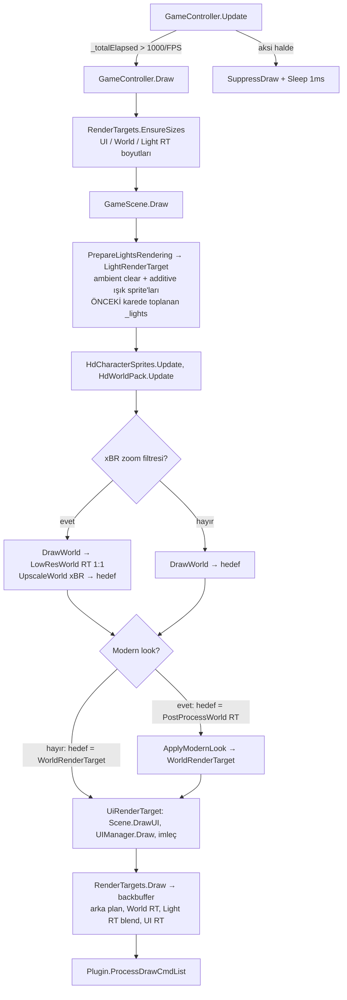

# Render Pipeline Haritası

> Taban: **classicUO-T** `main` = upstream ClassicUO `ee79d7eb` (2025-11-26) + fork özellikleri
> (§8). .NET 10, FNA 25.09 (FNA3D), shader'lar `fx_2_0` (vs_3_0 / ps_3_0). Yollar `src/` altına göredir;
> satır numarası yerine metot adları esastır. Eski 2020 tabanının haritası `legacy/2020` dalındadır.

## 1. Bir karenin yolu

`DrawWorld` içeriği: `FillGameObjectList` (görünürlük, mesh visibility, `AddLight`) →
`RenderLists.DrawRenderLists` (chunk mesh'ler + listeler) → `Weather.Draw` → `DrawSelection`.
**Sıra önemli:** Modern look ışıklardan *önce* uygulanır; ışık RT'si sonra `RenderTargets.Draw`'da çarpılır
(bkz. §8 ve LIGHTING_PLAN).

- FPS limiti: `GameController.Update` → `_intervalFixedUpdate` (`Settings.FPS`); aksi halde `SuppressDraw()`.
  Pasif pencerede `ReduceFPSWhenInactive` ile düşük FPS.
- **Işıklar bir kare gecikmeli:** `PrepareLightsRendering`, `DrawWorld`'den önce çalışır; `AddLight`
  çağrıları ise `DrawWorld` içinde (`FillGameObjectList` + view `Draw`'ları) yapılır → çizilen `_lights`
  bir önceki karenin listesidir. Hareket eden ışık kaynağında 1 kare kayma.
- Zoom ve kamera kayması `Camera.ViewTransformMatrix` ile uygulanır; RT'ler viewport boyutundadır
  (2020 tabanındaki "RT'yi Scale ile büyüt" yaklaşımı yok).

## 2. Kritik sınıflar

### Döngü ve sahne
| Sınıf — dosya | Sorumluluk | Önemli üyeler |
|---|---|---|
| `GameController` — `ClassicUO.Client/GameController.cs` | FNA `Game`; döngü, kare akışı | `Update`, `Draw`, `_renderTargets`, `_uoSpriteBatch`, `DpiScale` |
| `UltimaOnline` (`Client.Game.UO`) — `ClassicUO.Client/Client.cs` | Asset ve GPU kaynaklarının yüklenmesi | `Load`: hue texture'ı (`Textures[1]`, 512×1024), **ışık renk tablosu** (`Textures[2]`, 32×63), `Arts`, `Gumps`, `Texmaps`, `Animations`, `Lights` |
| `Scene` — `Game/Scenes/Scene.cs` | Sahne tabanı | `Camera`, `Update`, `Draw(batcher, renderTargets)`, `DrawUI` |
| `GameScene` — `Game/Scenes/GameScene.cs` | Dünya sahnesi | `Draw`, `DrawWorld`, `PrepareLightsRendering`, `InitializeRenderTargets`, `AddLight`, `UseLights`, `UseAltLights`, `DrawUI`, `_darknessBlend`, `_altLightsBlend`, `LightData` |
| `GameScene` (partial) — `Game/Scenes/GameSceneDrawingSorting.cs` | Görünürlük, alfa, mesh görünürlüğü, liste doldurma | `FillGameObjectList`, `AddTileToRenderList`, `ProcessStaticLikeTail`, `PushToRenderQueue`, `UpdateMaxDrawZ`, `GetViewPort`, `ApplyMeshHue`, `_visibleChunks`, `_renderLists` |
| `RenderLists` — `Game/Scenes/RenderLists.cs` | Kategori listeleri ve çizim sırası | `Add`, `DrawRenderLists(… visibleChunks …)`, `DrawMeshLayer`, `DrawRenderList` |
| `ChunkMesh` — `Game/Map/ChunkMesh.cs` | Chunk başına land/statik GPU mesh'i | `Land`, `Statics` (`MeshLayer`); nesnelere `InChunkMesh` / `MeshSpriteIndex` atar |
| `Camera` — `ClassicUO.Renderer/Camera.cs` | Viewport, zoom, offset (lerp), dönüşümler | `Bounds`, `Zoom`, `ViewTransformMatrix`, `ScreenToWorld`, `WorldToScreen`, `Update` |
| `RenderTargets` — `ClassicUO.Renderer/RenderTargets.cs` | UI/World/Light RT'leri ve **son birleştirme** | `EnsureSizes`, `SetLightsConfiguration(blend, hue)`, `Draw` |
| `WorldViewportGump` — `Game/UI/Gumps/WorldViewportGump.cs` | Oyun penceresi çerçevesi/boyutu | Dünyayı artık çizmez; kamera sınırlarını belirler |

### View'lar (`ClassicUO.Client/Game/GameObjects/Views/`)
| View | Not |
|---|---|
| `View.cs` (sınıf: `GameObject` abstract partial) | `GameObject.Draw(batcher, x, y, depth)`, `GameObject.CalculateDepthZ()` (tile X/Y + `PriorityZ` + hareket ofseti → derinlik) |
| `LandView.cs` | Düz land / `DrawStretchedLand` (köşe normalleri, `SHADER_LAND*`) |
| `StaticView.cs`, `ItemView.cs`, `MultiView.cs` | Mesh dışında kalanlar (animasyonlu, hareketli, hue'lu vb.); `IsLight` → `AddLight` |
| `MobileView.cs` | Katmanlı animasyon, `DrawShadow`; elde ışık → `AddLight(this, item, …)` |
| `GameEffectView.cs`, `LightningEffectView.cs`, `GameObjects/DragEffect.cs` | Efektler; ışıklı efekt → `AddLight` |

Chunk mesh'teki statiklerin ışığı view'dan değil `GameSceneDrawingSorting` içinden eklenir
(`ProcessStaticLikeTail` ve `AddTileToRenderList`'teki mesh döngüsünde `IsLight` kontrolü).

### Batcher, shader, efektler (`ClassicUO.Renderer/`)
| Sınıf — dosya | Sorumluluk | Önemli üyeler |
|---|---|---|
| `UltimaBatcher2D` — `Batcher2D.cs` | Sprite batcher + mesh çizimi | `Begin(effect, matrix)`, `End`, `Draw(...)` aşırı yüklemeleri (`texture, position/rect, sourceRect, hue, depth`), `DrawStretchedLand`, `DrawShadow`, `DrawCharacterSitted`, `DrawTiled`, `DrawDirectIndexed`, `SetWorldOffset`, `SetBlendState`, `SetStencil`, `SetSampler`, `SetBrightlight`, `SetCircleOfTransparencyRadius`, `GetDynamicIndexBuffer` |
| `MeshLayer` — `MeshLayer.cs` | Hazır vertex buffer + görünürlük/alfa/hue yamaları | `WriteQuadAt`, `SetVisible`, `SetHue`, `BuildVisibleIndices`, `UploadVisibleIndices`, `FlushAlphaChanges` |
| `BasicUOEffect` — `Effects/BasicUOEffect.cs` | `IsometricWorld.fx` sarmalayıcısı | `MatrixTransform`, `WorldMatrix`, `Viewport`, `Brighlight`, `CircleOfTransparencyRadius` |
| `XBREffect` — `Effects/XBREffect.cs` | xBR upscale | |
| `Resources` (partial, `Batcher2D.cs` sonu) | Shader gömme: `[FileEmbed.FileEmbed("shaders/X.fxc")]` | `GetUOShader`, `GetXBRShader` |
| `Light` — `Lights/Light.cs` | light.mul şekilleri → 2048² `TextureAtlas` | `GetLight(id)` → `SpriteInfo` (Texture + UV) |
| `TextureAtlas`, `SpriteInfo` | Art/gump/light atlas yapısı | |
| `ShaderHueTranslator` — `ShaderHueTranslator.cs` | Hue → `Vector3(hue, mode, alpha)` | `SHADER_*` sabitleri, `GetHueVector` |
| `Batching/*Command.cs` | Plugin çizim komut listesi (`Plugin.ProcessDrawCmdList`) | |

**Batcher durumu:** depth buffer **açık** — `DrawWorld` içinde `SetStencil(DepthStencilState.Default)`;
her sprite `CalculateDepthZ()` ile bir `depth` taşır. Saydam liste (`_transparentObjects`) yine çizim
sırasına güvenir. Sampler'lar: s0 sprite, s1 hue tablosu, s2 ışık renk tablosu.

### Hue ve shader modları
- Hue texture: 512×1024, 16 sütun × 1024 satır, her hue 32 ton (`get_rgb`).
- Vertex `Hue = (hue, mode, alpha)`. **`Z` opaklıktır** (1 = opak; `>1` = circle-of-transparency işaretli). 2020 tabanında tersiydi.
- `IsometricWorld.fx` modları:

| mode | Sabit | Etki |
|---|---|---|
| 0 | NONE | texture |
| 1 / 2 | HUED / PARTIAL_HUED | hue paleti / yalnız gri pikseller |
| 3 / 4 | HUE_TEXT_NO_BLACK / HUE_TEXT | metin |
| 5 / 6 | LAND / LAND_COLOR | normal × `get_light` (yön `(0,1,1)`; `Brightlight` = `TerrainShadowsLevel*0.1` kontrastı) |
| 7 | SPECTRAL | siyah + kırmızıdan alfa |
| 8 | SHADOW | %40 siyah |
| 9 | LIGHTS | `get_colored_light(Hue.x-1, color.r)` → s2 ışık renk tablosu |
| 10 | EFFECT_HUED | yeşil kanaldan hue |
| 11 / 12 | NATURE_GRASS / NATURE_GRASS_LIT | (classicUO-T) canlı çimen `grade_grass`; 12 = + `get_light` |
| +20 | GUMP | |

## 3. Mevcut ışık sistemi

**Veri**
- `LightsLoader` — `ClassicUO.Assets/LightsLoader.cs`: `light.mul`/`lightidx.mul`, `MAX_LIGHTS_DATA_INDEX_COUNT = 100`.
- `Light` — `ClassicUO.Renderer/Lights/Light.cs`: ışık şekillerini atlas'a koyar.
- `LightColors` — `ClassicUO.Client/Game/Data/LightColors.cs` (veri dosyaları `<exe>/Data/Client/`):
  - `lightshaders.txt`: `ID RGB R_CURVE G_CURVE B_CURVE` (en fazla 63 ışık "shader"ı; `LightShaderCurve` 6 eğri). `CreateLightTextures` bunları 32×63 renk tablosuna (s2) yazar; `BuildLightShaderFiles` varsayılanı üretir.
  - `lights.txt`: `ITEM_ID SHADER` veya `ITEM_ID H<hue>` → item'a özel ışık rengi (`LoadLights`).
  - `GetHue(graphic, out color, out isHue)`; `LightShaderData` — `Game/Data/LightShaderData.cs`.
- `IsometricLight` — `Game/GameObjects/IsometricLight.cs` (`World.Light`): `Overall/Personal`, `RealOverall/RealPersonal`;
  `IsometricLevel = max(Personal, 32-Overall)/32` (2020 ile aynı formül; `Personal` ile `32-Overall`'ın aynı ölçekte karşılaştırılması şüpheli).

**Paketler** — `ClassicUO.Client/Network/PacketHandlers.cs`: `0x4E PersonalLightLevel`, `0x4F LightLevel`, `0x65 SetWeather`.
Profil (`Configuration/Profile.cs`): `UseCustomLightLevel`, `LightLevel`, `LightLevelType` (0 mutlak / 1 minimum),
`UseColoredLights`, `UseDarkNights` (−0.04), `UseAlternativeLights`, `TerrainShadowsLevel`.

**Akış**
1. `AddLight(obj, lightObject, x, y)`: tile `(X+1, Y+1)` örtme testi (2020 ile aynı); ID seçimi
   (özel aralıklar → 2, `Item.LightID`, `ItemData.LightIndex` + mobil yönüne göre el ofseti, mobil → 1);
   `LightID > 200` → renk = ID−200; `LightColors.GetHue`. Limit: **100 ışık/kare** (`MAX_LIGHTS_DATA_INDEX_COUNT`).
2. `PrepareLightsRendering`: Light RT'yi `IsometricLevel` grisiyle temizle (alternatif mod: siyah);
   `Begin(null, cameraMatrix)`, `BlendState.Additive`; her ışık için atlas sprite'ı, mod `SHADER_LIGHTS` (s2) veya `SHADER_HUED`.
3. `InitializeRenderTargets` → `RenderTargets.SetLightsConfiguration(blend, hue)`.
4. `RenderTargets.Draw`: World RT üstüne Light RT; `_darknessBlend` (dst×src) veya `_altLightsBlend` (dst + src×dst, alfa 0.5).
5. `UseLights` yalnızca `Personal < Overall` iken true (gündüz Light RT şeffaf temizlenir, ışık çizilmez).

**Zayıflıklar:** LDR çarpımsal (overbright yok), 5-bit ışık şekilleri, anlık geçişler, gri ambient,
100 ışık limiti, 1 kare gecikme, Light RT ölçek/blur yok.

## 4. Render target'lar

| RT | Boyut | Format | Kullanım |
|---|---|---|---|
| `UiRenderTarget` | pencere / DPI | backbuffer formatı + depth | UI, overhead'ler, imleç |
| `WorldRenderTarget` | `Camera.Bounds` (DPI sonrası) | backbuffer formatı + depth | Dünya |
| `LightRenderTarget` | World ile aynı | backbuffer formatı | Işık haritası |
| `GetLowResWorldRenderTarget` (classicUO-T) | World / zoom | backbuffer + depth | xBR zoom filtresi: dünya 1:1 çizilir, sonra büyütülür |
| `GetPostProcessWorldRenderTarget` (classicUO-T) | World ile aynı | backbuffer + depth | Modern look açıkken dünya önce buraya, sonuç `WorldRenderTarget`'a |

`RenderTargets.EnsureSizes` her karede boyutu kontrol eder, değişirse yeniden oluşturur.
Birleştirme sampler'ı: tam sayı DPI'da `PointClamp`, değilse `LinearClamp`.

## 5. Derinlik ve çizim sırası

- `RenderLists.DrawRenderLists` sırası: chunk mesh land → mesh dışı land (`_tiles`, `_stretchedTiles`)
  → chunk mesh statikler → mesh dışı statikler → `_animations` (mobil, ceset) → `_effects`
  → `_transparentObjects` → dünya içi gump sprite/yazıları.
- Derinlik `GameObject.CalculateDepthZ()` (`Views/View.cs`); mesh layer'lar `SetWorldOffset(offsetX, offsetY)` ile kaydırılır.
- `UpdateMaxDrawZ` çatı/üst kat kesmesini (`_maxZ`, `_maxGroundZ`, `_noDrawRoofs`) yönetir.

## 6. Genişletme noktaları

| # | Nokta | Uygun iş |
|---|---|---|
| E1 | `GameScene.Draw` — `PrepareLightsRendering` / `DrawWorld` sırası | Işık pass'ini dünyadan **sonraya** almak (gecikmeyi kaldırır) |
| E2 | `GameScene.PrepareLightsRendering` | Yeni ışık haritası üretimi (kendi RT'mize) |
| E3 | `GameScene.AddLight` | Işık toplama, tanım, flicker, yarıçap |
| E4 | `RenderTargets.SetLightsConfiguration` / `RenderTargets.Draw` | **Kompozit**: blend state ve ışık texture'ı; M5 post-process zinciri |
| E5 | `GameScene.DrawWorld` — `End()` öncesi | Dünya üstü katmanlar (sis, bulut gölgesi) |
| E6 | `IsometricWorld.fx` yeni mod (**≥ 13**; 11–12 nature) | Sprite başına efekt (su vb.). Tek shader → herkes etkilenir |
| E10 | `GameScene.Draw` — `DrawWorld`/`UpscaleWorld` sonrası, `ApplyModernLook` öncesi | Dünya görüntüsüne tam çözünürlükte uygulanan pass'ler (ışık kompoziti, sis); Modern look bunları da işler |
| E7 | `Resources` (FileEmbed) + yeni `Effect` sınıfı | Yeni shader dosyaları |
| E8 | `IsometricLight` | Ambient / gün-gece eğrisi |
| E9 | `MeshLayer` / `ChunkMesh` | Statik geometriye vertex başı veri (ör. bitki salınım ağırlığı) |

Kural: yeni kod `ClassicUO.Client/Game/Lighting/` (oyun mantığı) ve `ClassicUO.Renderer/Lighting/`
(GPU) altında; upstream dosyalarda yalnızca küçük, koşullu kancalar.

## 7. Kısıtlar ve riskler

- **Shader derleme:** repoda `shaders/fxc.exe` + `compile_shaders.bat` (Windows). `.fxc` repoya girer ve
  FileEmbed ile gömülür; `.fx` değişip `.fxc` güncellenmezse etki görünmez. MojoShader → SM3 sınırları.
- **Depth texture örneklenemez** (FNA/fx_2_0): depth tabanlı occlusion/gölge (M2) için derinliği ayrı bir
  renk hedefine yazmak (MRT) gerekir.
- **Chunk mesh:** statiklerin çoğu tek tek `Draw` edilmez; sprite başına özel veri gerekiyorsa `MeshLayer`
  vertex verisine yazılmalı (hue alanı `SetHue` ile yamalanır).
- **Tek global effect:** `IsometricWorld.fx` UI dahil her şeyi çizer; mod eklemek güvenli, mevcut modları değiştirmek riskli.
- **Vertex alanları dolu (classicUO-T):** `TexCoord.z` = rüzgâr salınım genliği (üst köşeler), `Normal.x` = salınım fazı
  (yalnız land dışı modlarda; land modları `Normal`'ı normal olarak okur), `Hue.x` = çimen tonu (mod 11/12).
  Yeni per-vertex veri için boş alan kalmadı → vertex formatı değişikliği gerekir.
- **Light RT formatı = backbuffer formatı** (8-bit). Overbright/HDR için kendi RT'mizi oluşturmalıyız.
- **Bir kare ışık gecikmesi** (§1).
- **`MAX_LIGHTS_DATA_INDEX_COUNT`** hâlâ hem ID hem kare başına ışık limiti.
- **Plugin draw komutları** (`Plugin.ProcessDrawCmdList`) son kareye çizilir; post-process bunları etkilememeli.

## 8. classicUO-T eklemeleri (render'a etkisi)

Hepsi profil ayarıyla açılır/kapanır (`Configuration/Profile.cs`); varsayılan kapalı (`MovementStepCadence` vb. hariç).

| Özellik | Profil | Ana dosyalar | Render yoluna etkisi |
|---|---|---|---|
| Nature effects | `NatureEffects` | `Game/Data/NatureTiles.cs`, `Game/Map/ChunkMesh.cs` (`Decor` layer), `IsometricWorld.fx` (`Time`, mod 11/12, vertex sway) | Çimen tutamları `ChunkMesh.Decor` layer'ında, `DepthRead` ile land'den sonra çizilir; bitki/ağaç üst köşeleri vertex shader'da sallanır (`Batcher2D.SetSway`, `MeshLayer.SetSway`, `UltimaBatcher2D.SetTime`). Değişince chunk mesh'ler yeniden kurulur (`BuiltWithNatureEffects`). |
| Zoom pixel art filtresi | `ZoomPixelArtFilter` | `GameScene.Draw` (`UpscaleWorld`, `_worldRenderScale`), `RenderTargets.GetLowResWorldRenderTarget`, `XBREffect` | Zoom ≥ 1.25× iken dünya 1:1 çizilip xBR ile büyütülür. HD world pack varsa devre dışı. |
| HD karakterler | `HdCharacters` | `Game/Managers/HdCharacterSprites.cs`, `ClassicUO.Renderer/Animations/HdSpriteCache.cs`, `XbrSprite.cs` | Mobil kareleri zoom'da 2× xBR kopyalarından çizilir (`MobileView`). |
| HD world pack | `HdWorld` | `Game/Managers/HdWorldPack.cs`, `tools/hdpack/` (Python), `Data/HD/world/` | Land/texmap/statik için 2× görüntüler (zoom dışı yarıya indirilir); ayrı atlas; geometri/seçim/sıra orijinalle aynı, yalnız texture değişir. Mesh'ler `BuiltHdGeneration` değişince yeniden kurulur. |
| Modern look | `ModernLook` | `shaders/ModernLook.fx`, `Effects/ModernLookEffect.cs`, `GameScene.ApplyModernLook` | Dünya görüntüsüne keskinlik, glow (luma > 0.62), renk düzenleme, vignette. **Işıklardan önce** uygulanır → Light RT katkısı glow almaz; yalnız dünya görüntüsünde zaten parlak olan kaynak art (alev, lav) eşiği aşarsa glow alır. |
| Smooth movement | `Movement*` | `PlayerMobile`, `Mobile`, `Data/MovementSpeed.cs`, `Managers/MovementDiagnostics.cs`, `GameController` (`timeBeginPeriod(1)`) | Render yolu değişmez; kare zamanlaması düzgünleşir. `EnableVSync` ayarı eklendi. |
